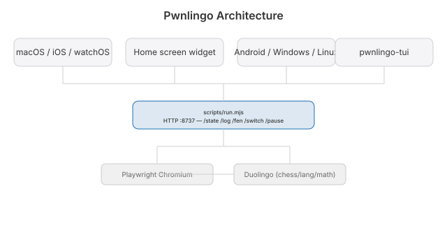

# Cruise

[](LICENSE)

**Live:** https://pwnlingo.jaybulb.com

Plays Duolingo for you. Languages, math, chess. Music is wired up too, but Duolingo doesn't serve it on desktop web, so it has nothing to play yet.

It runs its own Chrome, signed in with your session cookie, and reads each question's answer out of the page's React state. Where there is no answer on the page (math), it solves the question itself. Nothing is guessed. A wrong answer means a bug, and the log says which question.


Automating Duolingo is against their terms of service and can get your account banned. Use it on an account you can afford to lose.

## Architecture



## Run

```sh
cd scripts
echo "<your jwt_token cookie>" > jwt.txt
node run.mjs es       # any language code
node run.mjs math
node run.mjs chess
node run.mjs music
```

One track at a time; Duolingo keeps one active course per account. Progress lands in `state.json`, every event in `log.jsonl`, and every language question and answer in `lessons.jsonl` so you can review what you practised.

`run.mjs` also serves `state.json`/`log.jsonl` over the LAN on port 8737, and switches track live on `POST /switch?track=<x>` — no restart needed. The status app (below) drives this.

## Runs itself

The status app is the only thing that starts `run.mjs`, and it's already
wired to survive a reboot and a crash:

- `~/Library/LaunchAgents/com.nulljosh.cruise-status.plist` (RunAtLoad +
  KeepAlive) brings the status app itself back after login or a crash.
- The status app then starts `run.mjs` on its saved track, and restarts it
  5s after any unexpected exit (network blip, browser closed, anything but
  a genuinely missing Duolingo session, which needs a human to log back in).
- Every 60s the status app also pings the runner on port 8737 and starts it
  if nothing answers. That catches a runner that died without the app
  noticing, which is how a streak day got missed on 2026-10-04.

If the runner freezes with its status port still answering, it notices that
nothing was logged for 45 minutes and exits so the app restarts it.

Two more things keep the account healthy while it plays:

- **Streak guard.** After 6pm local, if no XP has landed today, the runner
  logs `streak-risk` and hops from chess/math to a language course so a real
  lesson finishes before midnight. It plays through a pause to do it (manual
  or low disk), then the pause holds again.
- **Fastest track next.** At startup it measures XP per hour for each track
  from the logs (`xpRates` in `state.json`). When a track finishes or stalls
  it moves to the best earner still playable, not just the next in order.
- **Milestones.** `scripts/milestones.jsonl` gets one line for every 10k XP,
  every 10 streak days, each day the daily quests are all done, and each
  course finished. It never rotates, unlike `log.jsonl`.
- **Quests.** Every 30 min it reads the daily quests on `/quests` (`quests`
  in the log). Their chests open on their own once a quest fills, so the job
  is finishing them: if progress sat still since the last look while on
  chess or math, it switches to a language course (`quest-focus`) and comes
  back when they are done (`quest-return`). A quest that a language course
  can't move either is left alone for the day.
- **Rewards.** On the same visit it clicks any `CLAIM` button, and opens
  any treasure chest on the `/learn` path (`chest-open` in the log; a
  `chest-visit` with 0 chests means none were on the path).
- **Celebrate.** Every 6h it opens your profile feed and clicks `CELEBRATE`
  on friends' achievements (`celebrate` in the log, with how many were sent
  and how many are left). These need a real mouse click, not a DOM click.
- **Gifts.** On the same `/quests` visit it clicks `SEND GIFT` for a friend
  when the button is there (`gift-sent` in the log). It only matches the free
  gift label, never anything that looks like a purchase.

To wire this up on a fresh machine: build the app once
(`cd app && xcodegen generate && xcodebuild -scheme CruiseStatus-macOS
-configuration Debug -derivedDataPath build build`), then
`launchctl load ~/Library/LaunchAgents/com.nulljosh.cruise-status.plist`
(copy that plist in first if it's not already there — see `app/`). From then
on it survives reboots and crashes with no manual restarts.

## Status app

Native everywhere: SwiftUI on iOS/macOS/watchOS, Compose Multiplatform on Android/Windows/Linux, plus a terminal client (`cruise-tui`). All poll the runner over the LAN or tunnel for the same state: current track, XP gained, puzzles/misses/matches or lesson count, live chess board, and the latest log line. Switch track or pause from any client, no terminal needed.

## Files

- `scripts/run.mjs` drives the browser, opens lessons, clicks through, rotates languages, serves LAN status + track switching.
- `scripts/solver.js` answers language, chess, and story questions.
- `scripts/math.js` answers math. It is large because math has no answer key on the page.
- `scripts/js-chess-engine.js` plays the chess bot.
- `app/` is the iOS/macOS status app (xcodegen, no checked-in `.xcodeproj`).
- `SKILL.md` and `CLAUDE.md` hold the gotchas that cost time. Read them before touching the solver.
- `web/` is the landing page at pwnlingo.jaybulb.com.

## Honest notes

Automated play is against Duolingo's terms. XP earned this way ranks you against real people in your league. Listen questions are skipped. Speak questions are voiced with macOS `say` through a fake mic (the sentence is on the page already, same as any other answer key) — unverified against a live speak screen yet, falls back to skip if the record button isn't found. DuoRadio is skipped.
