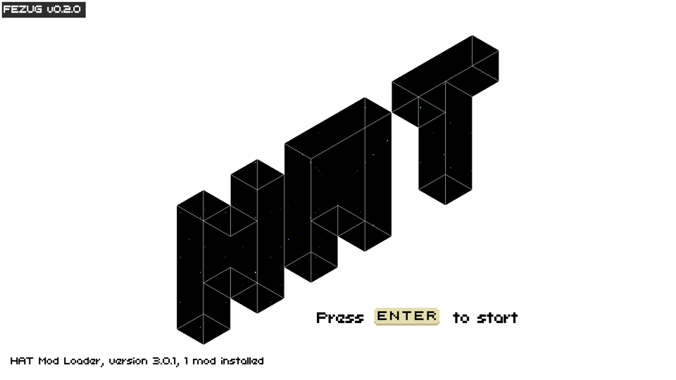
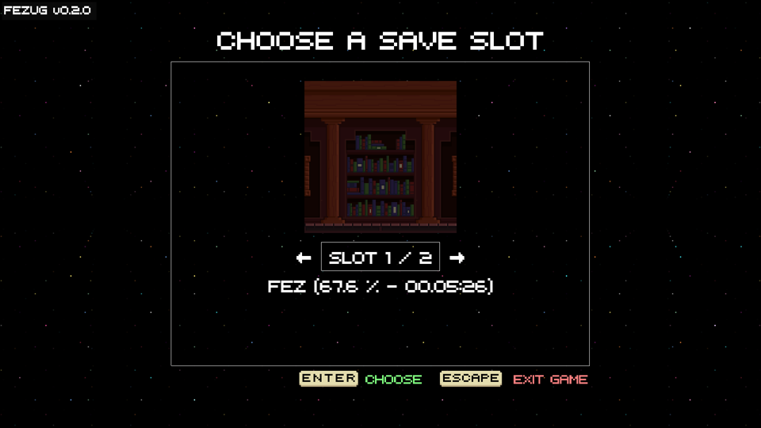
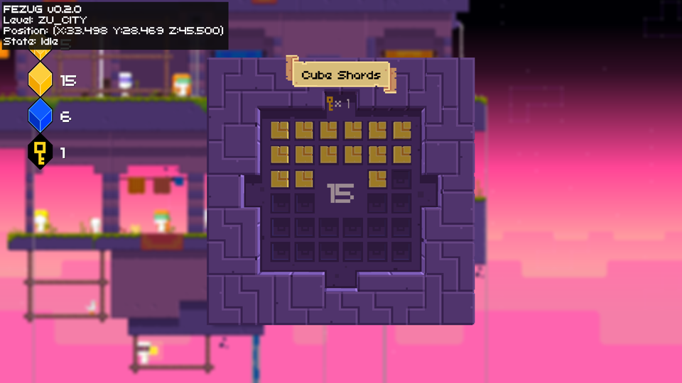
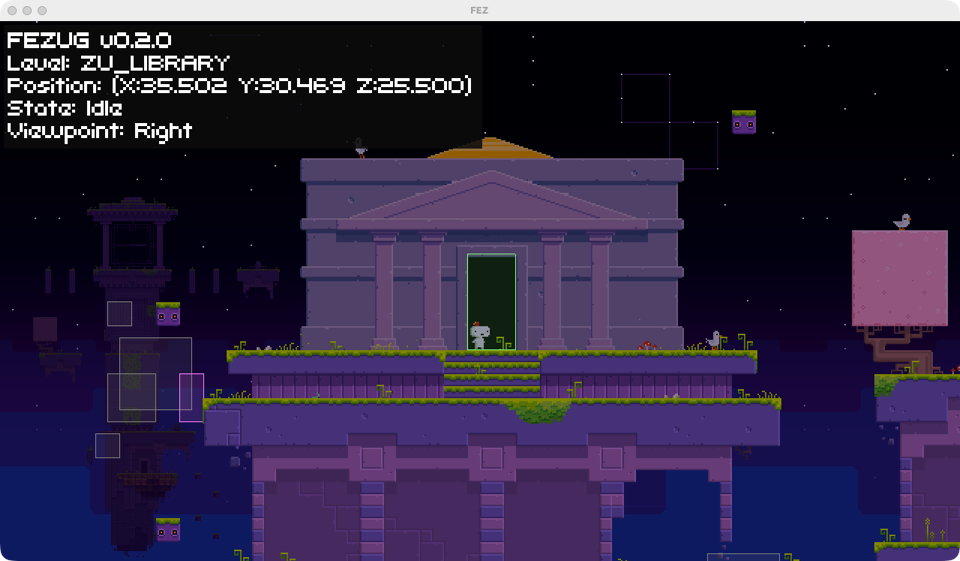

FEZ on Surf. The goal is the 32-cube ending, played for real from Joshua's own save.

## How it plays

FEZ runs with two community mods. [HAT](https://github.com/FEZModding/HAT) is the mod loader. It patches the game once, and the vanilla copy stays in `FEZ.app/Contents/MacOS/Original/`. [FEZUG](https://github.com/FEZModding/FEZUG) is a speedrun practice tool that adds a console on the `~` key.

`fez.py` drives the game in the background. Keys go straight to the FEZ process (`CGEvent.postToPid` in `key.swift`) and screenshots come from the FEZ window id (`win`, built from `games/factorio/scripts/win.swift`), so FEZ runs windowed behind the terminal and never needs focus. FEZ's Settings has `pauseOnLostFocus false` and a 1280x720 window.

`fezsave.py` reads a save and lists what is left to collect in every room, by comparing it with the game's own map tree. `fezmap.py` reads the level files: the doors in a level, the room route between two levels, and an ASCII side view of a level from any of the four angles. Both need the game data unpacked with [FEZRepacker](https://github.com/FEZModding/FEZRepacker) (`--unpack Other.pak`), which lives on the LaCie with its .NET SDK.

```bash
python3 fez.py key right+space 600 150   # run right, jump 150 ms in
python3 fez.py cmd "hud_position 1"     # FEZUG console command
python3 fez.py shot name                # screenshot to shots/
```

The console is used only to read state (the level, position and state HUD, and cube wireframes). Item counts, progress flags and warps are off limits: Joshua wants the game beaten by playing it.

## Saves

Steam Cloud holds two saves: `saveslot0` (Feb 2025, 67.6%) and `saveslot1` (2016). Both are backed up in `.save-backup/` (gitignored). Surf plays slot 3 (`SaveSlot2`), a copy of slot 0, so Joshua's own slot stays his.

## Progress log

**2026-10-25.** HAT 3.0.1 and FEZUG 0.2.0 installed and loading.



Joshua's save turned up in Steam Cloud at 67.6%.



The real inventory is 15 gold cubes, 5 of 8 bits, 6 anti-cubes and 1 key. Anti-cubes count toward the door, so that's 21 of 32. The 32-cube door is in New Zu City and leads to the Star Gate.



A first attempt set the cube count with the console and warped to Zu City. Joshua called it out as skipping the game, so it was reverted and slot 3 was restored from the backup. Regions never visited in the save are Industrial City, the sewers, the mines and the lava caves. Most of the 11 missing cubes are there.

**2026-10-25, 13:45.** FEZ runs windowed behind the terminal now, with keys sent straight to the game process. Cubes are still 21 of 32 (15 gold, 6 anti, 5 of 8 bits). Gomez is in Zu Library, trying to get down to the Clock Tower door under the building. One try ended in a black hole. FEZUG's volume overlay now draws the black holes and doors, and the black holes seem to switch on and off. ETA: unknown. Navigation is the bottleneck, at about one room an hour so far, with roughly 20 unvisited rooms to cover.


