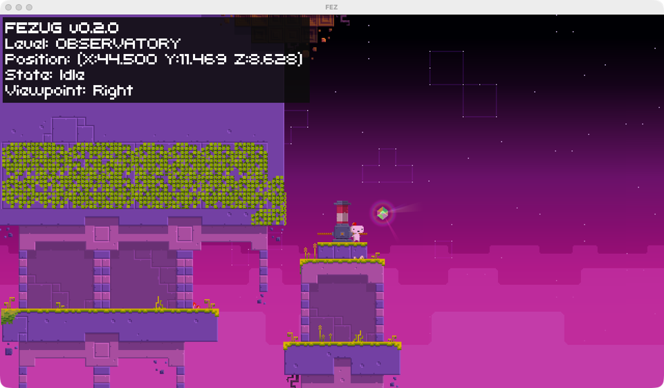
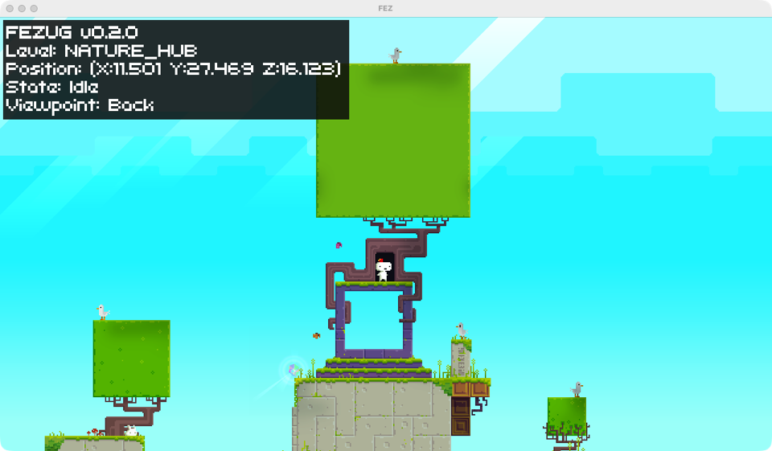
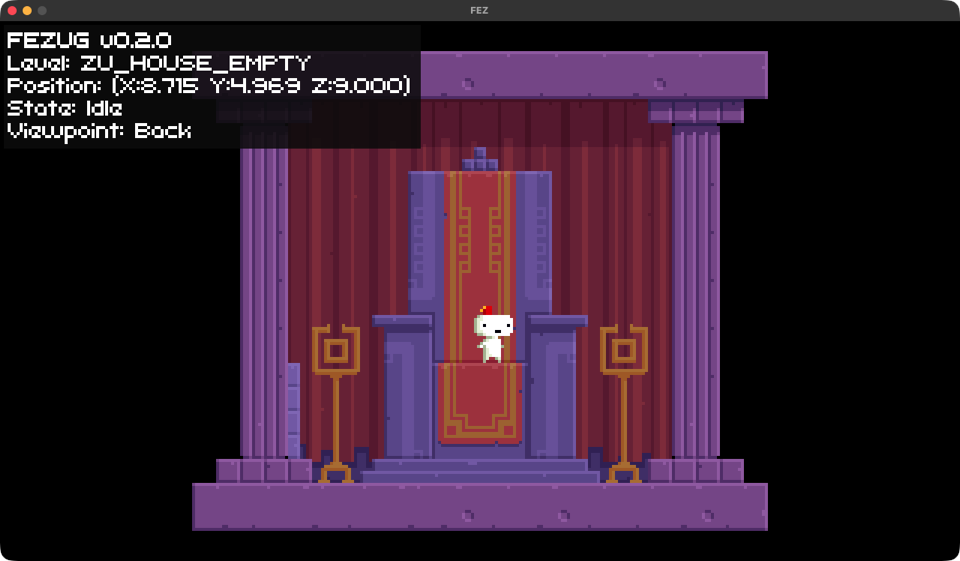
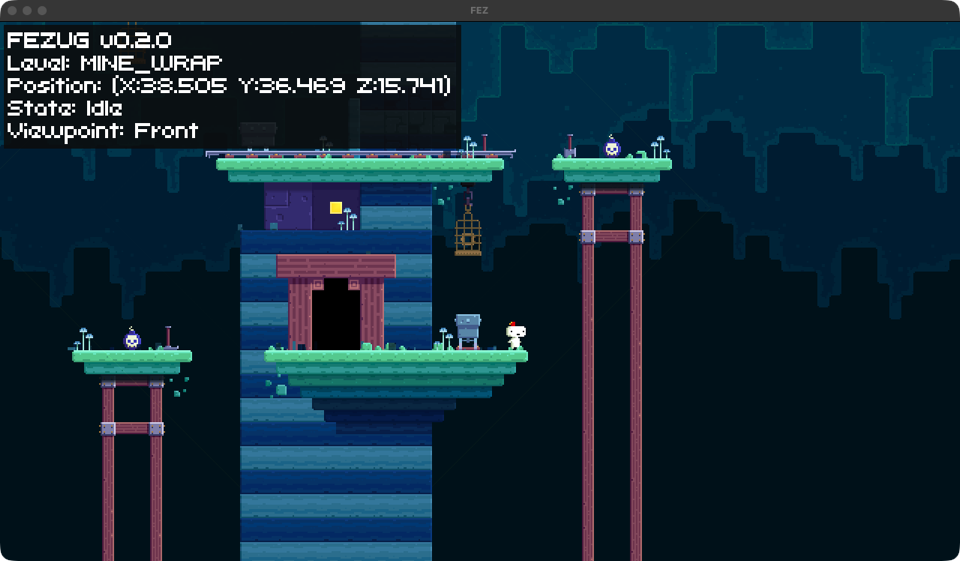
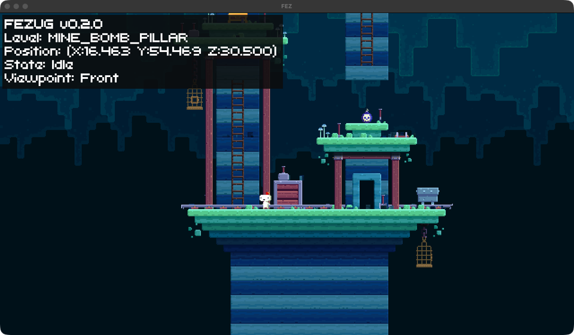

FEZ on Duke. The goal is the 32-cube ending, played for real from Joshua's own save.

## How it plays

FEZ runs with two community mods. [HAT](https://github.com/FEZModding/HAT) is the mod loader. It patches the game once, and the vanilla copy stays in `FEZ.app/Contents/MacOS/Original/`. [FEZUG](https://github.com/FEZModding/FEZUG) is a speedrun practice tool that adds a console on the `~` key.

`fez.py` drives the game in the background. Keys go straight to the FEZ process (`CGEvent.postToPid` in `key.swift`) and screenshots come from the FEZ window id (`win`, built from `games/factorio/scripts/win.swift`), so FEZ runs windowed behind the terminal and never needs focus. FEZ's Settings has `pauseOnLostFocus false` and a 1280x720 window.

`fezsave.py` reads a save and lists what is left to collect in every room, by comparing it with the game's own map tree. `fezmap.py` reads the level files: the doors in a level, the room route between two levels, and an ASCII side view of a level from any of the four angles. Both need the game data unpacked with [FEZRepacker](https://github.com/FEZModding/FEZRepacker) (`--unpack Other.pak`), which lives on the LaCie with its .NET SDK.

```bash
python3 fez.py key right+space 600 150   # run right, jump 150 ms in
python3 fez.py cmd "hud_position 1"     # FEZUG console command
python3 fez.py shot name                # screenshot to shots/
```

The console is used only to read state (the level, position and state HUD, and cube wireframes). Item counts, progress flags and warps are off limits: Joshua wants the game beaten by playing it.

## Saves

Steam Cloud holds two saves: `saveslot0` (Feb 2025, 67.6%) and `saveslot1` (2016). Both are backed up in `.save-backup/` (gitignored). Duke plays slot 3 (`SaveSlot2`), a copy of slot 0, so Joshua's own slot stays his.

## Progress log

**2026-10-25.** HAT 3.0.1 and FEZUG 0.2.0 installed and loading.


Joshua's save turned up in Steam Cloud at 67.6%.


The real inventory is 15 gold cubes, 5 of 8 bits, 6 anti-cubes and 1 key. Anti-cubes count toward the door, so that's 21 of 32. The 32-cube door is in New Zu City and leads to the Star Gate.


A first attempt set the cube count with the console and warped to Zu City. Joshua called it out as skipping the game, so it was reverted and slot 3 was restored from the backup. Regions never visited in the save are Industrial City, the sewers, the mines and the lava caves. Most of the 11 missing cubes are there.

**2026-10-25, 13:45.** FEZ runs windowed behind the terminal now, with keys sent straight to the game process. Cubes are still 21 of 32 (15 gold, 6 anti, 5 of 8 bits). Gomez is in Zu Library, trying to get down to the Clock Tower door under the building. One try ended in a black hole. FEZUG's volume overlay now draws the black holes and doors, and the black holes seem to switch on and off. ETA: unknown. Navigation is the bottleneck, at about one room an hour so far, with roughly 20 unvisited rooms to cover.


**2026-10-25, 15:30.** Duke plays FEZ on its own now. `SurfBridge` (in `bridge/`, Duke's own HAT mod) writes Gomez's live position, the level's collectibles, moving platforms and black holes to a JSON file several times a second. `plan.py` flattens a level the way each camera angle sees it, then finds a route of walks, drops, hops, ledge grabs, vine climbs and camera turns, tracking Gomez's depth across turns. `go.py` plays the route and replans whenever he lands somewhere unexpected. That took Gomez from Zu Library through the Clock Tower and Zu City Ruins into the Observatory. Lessons from play: jumping before a drop adds enough fall height to kill him, so the safe drop is 5. Time switches are grabbed from the side and unscrewed by turning the camera. The Observatory's gold cube sits behind a chain of three timed switches that flip vine-covered blocks. Cubes: still 21 of 32. ETA: unknown until the puzzle rooms are counted. `triage.py` is sorting the remaining rooms into ones the planner can clear outright and ones that need a puzzle solved first.



**2026-10-25, 16:00.** Duke's own planner walked Gomez from Zu City Ruins through Zu Bridge, the Throne room, Tree Sky, the whole Tree and Tree Roots to the Nature Hub, with nobody steering. Rules learned from play and now in `plan.py`:
- Gomez only collides with the block nearest the camera, so a shelf or vine hidden behind the trunk doesn't count.
- Vines can be climbed from every angle. Ones seen edge-on only go up and down.
- Mushrooms are bouncers that throw him about 7 up.
- From standing, a fall longer than about 7.5 kills him. After a bounce he can fall about 15.
- Water breaks any fall, and a jump out of water peaks about 2.9 up.
- Black holes re-roll on every level load, so a dead end restarts the game.

Cubes: still 21 of 32. The Mines (a gold cube and 3 bits) are next. The run was stopped when the Mac ran critically low on memory.



**2026-10-26, overnight.** Cubes: 22 of 32, with 2 of 8 bits toward the next. Eight bits merged into cube 22 in Zu City's empty house. Gomez also bombed open both Mines doors, climbed Zu City's bobbing pillars, and opened Memory Core's 8-bit door into Industrial City.

The biggest change is that the planner now asks the game itself. The SurfBridge mod dumps FEZ's own collision answer for every camera angle to `surfgrid.json`, so plans no longer guess which block Gomez touches. It also exports whether Gomez is in the background and which door or volume he's in. Other rules learned overnight:
- Bomb blasts are screen-space 3x3 and chain through connected bricks. The fuse is 6 s from pickup, and the camera angle at the moment it blows decides which bricks break.
- Holding Up while jumping catches ledges, which is the only way out of water.
- Floating pillars bob up and down by one unit, so the jump waits for the top of the swing.
- A door only opens when nothing stands between it and the camera. Some doors open from one side only, and `blocked.txt` records them so routes go around.

Still locked behind puzzles the planner can't solve yet: the Lighthouse climb, Quantum (under the Bell Tower's water), CMY, Weightswitch, Fractal, and the Tree climb to the Graveyard.



**2026-10-26, 00:00.** Bits: 5 of 8 toward cube 23. Bit 3 in Mine A came from turning the camera in mid-air while falling with a bomb, which drops Gomez onto a ledge he couldn't climb to with his hands full. Bit 4 in Mine Wrap only needed the right angle. Bit 5 took most of the night, and reading the game's own source cracked it:
- A blast checks each screen cell from the camera inward and stops at the first solid block that isn't a brick (`BombsHost.DestroyNeighborhood`), so a wall in front shields the bricks behind it.
- A brick group only stays gone if every brick in it breaks. Otherwise the whole group grows back 1.5 s after the last one breaks.
- Mine Wrap's tower has one group of 56 bricks wrapped around all four faces. The way through is to set the chain off at floor level on the right face, then turn the camera Back, Left and Front as it climbs, so each face burns while the camera faces it. The room's name was the hint.
- The fuse is 4.0 s from the lift. Each camera turn pauses the game and adds about 0.33 s.
- A bomb only lifts when Gomez stands right on it, and only from in front of it.
- Corner ledges grab only when Gomez comes at the edge from outside it, moving toward it, with his middle within 0.35 of the top corner (`GrabCornerLedge`).

`bombrun.wrap_chain()` replays the whole thing. Next is Mine Wrap's top floor, which leads to the Bomb Pillar room (a bit and a chest) and a cube high above it.



**2026-10-26, 01:45.** Bits: 6 of 8. Mine Wrap's top floor fell to a corner grab from the hole bit 5 left behind. The Bomb Pillar door then opened to the right post's bomb, carried in Left view with the gap jump pressed early, because a jump pressed at the lip while carrying registers too late. Inside, the bit sat on one brick that only the Left camera can see, and the bomb on the hut roof blew it loose. A second bomb, thrown off the roof in a jump, cleared the 36-brick block inside the left pillar and opened its ladder. Still open: the chest on top of that pillar, which sits 2 tiles above what a jump off a ladder reaches, and Mine Wrap's gold cube. The live collision grid says nothing between the top floor and the cube's platform is solid, so the climb there is a puzzle not cracked yet. FEZ also stopped taking movement keys twice tonight. A restart fixes it, and progress survives as long as Gomez has gone through a door since.


