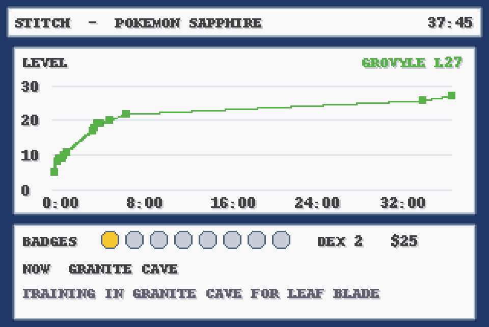

Duke plays Pokemon Sapphire headless and for real, as Stitch with Treecko. No cheats, and the only reloads undo the bot's own misinputs before an in-game save.

- `gba.c`: the player. It's built on Homebrew's libmgba (`brew install mgba`, then `./build.sh`) and opens no window. The bot talks to it on 127.0.0.1:8742 (`keys`, `r8`/`r16`/`r32`, `rd`, `shot`, `save`, `load`, `frame`, `turbo`), and raw frames go to stdout.
- `run.sh`: starts the player detached. It pipes the frames through ffmpeg to `udp://127.0.0.1:9000`, which OBS takes as a Media Source for the Twitch stream.
- `pk.py`: the client. `python3 pk.py A 'A*5' wait:60 shot:name save:name` presses keys, saves screenshots to `shots/` and states to `states/` (both gitignored). It also reads the game's active tasks and screen by name.
- `nav.py`: walking. It does a BFS over the live collision grid, reads the map's warps and sign events, and runs `talk()` through cutscenes.
- `mons.py`: decodes the encrypted party data.
- `stats.py`: appends a row to `progress.jsonl` (play time, place, badges, Pokedex, money, party).
- `graph.py`: draws `progress.png` in the game's text box style.
- `intro.py`: New Game through the naming screen.
- `play.py`: the run, leg by leg (`python3 play.py grind101 8`).
- `wallpaper.py`: an iPhone wallpaper, the live screen and party in the same style, saved as "Pokemon Wallpaper.jpg" at the top of iCloud Drive.

The ROM is Joshua's own dump at `~/roms/sapphire/` (US v1.1, SHA-1 4722efb8), never in the repo. The battery save sits next to it. Memory addresses come from pret/pokeruby's `pokesapphire_rev1.sym`, and the rules the bot relies on are in [GUIDE.md](GUIDE.md).

## Now
1 badge. Grovyle (L27) is training in Granite Cave for Leaf Blade, then a Brawly rematch. `docs/LOOP-HANDOFF.md` has the plan.
